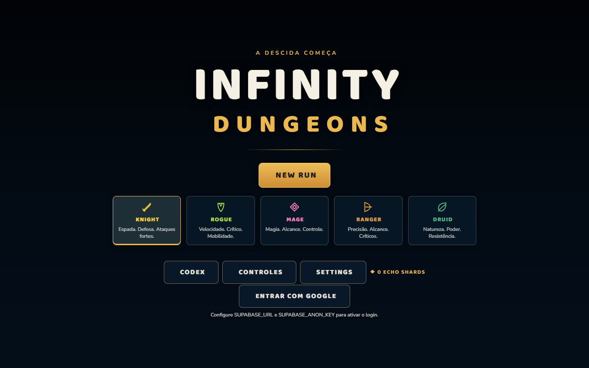

# Infinity Dungeons

Roguelike de masmorras infinitas jogado no navegador: cada descida gera um mapa novo, com biomas, salas e encontros diferentes.

## O jogo
- **5 classes**: Knight, Rogue, Mage, Ranger e Druid, cada uma com seu estilo de combate.
- **Masmorras geradas a cada partida**: caminhos longos, zigue-zagues e atalhos, com salas de combate em cruz, círculo, losango, labirinto, fosso ou ponte quebrada.
- **Biomas com cenário próprio**: basalto rachado, pilares de gelo, raízes da floresta, obeliscos de templo e colunas celestiais.
- **Equipamentos, mochila e relíquias**, com opção de equipar automaticamente os melhores itens.
- **Poderes e magias** organizados em um painel próprio.
- **Codex** com classes, relíquias, poderes e bestiário.
- **Semente de mapa** para repetir a mesma masmorra quando quiser.
- Login opcional com Google; o progresso fica salvo no navegador.

## Telas

---

Este repositório é uma **vitrine** do projeto: mostra o que o jogo é e como ele é. O código-fonte não é público.

Desenvolvido por [@won3er](https://github.com/won3er).